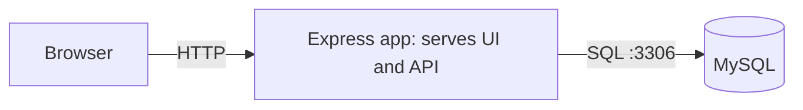

# Task Tracker: Three-Tier App with GitHub Actions CI/CD


A small task manager built as a **three-tier web application** (browser UI, Express API, MySQL database), packaged as a Docker image and built, tested and published to Docker Hub by a **GitHub Actions** workflow.

## Table of Contents

1. [Architecture](#architecture)
2. [Tech Stack](#tech-stack)
3. [Repository Structure](#repository-structure)
4. [API](#api)
5. [Configuration](#configuration)
6. [Run Locally with Docker Compose](#run-locally-with-docker-compose)
7. [Run Locally with Node.js](#run-locally-with-nodejs)
8. [Docker Image](#docker-image)
9. [CI/CD with GitHub Actions](#cicd-with-github-actions)
10. [Running the Published Image](#running-the-published-image)
11. [Security Notes](#security-notes)
12. [Known Limitations](#known-limitations)
13. [Troubleshooting](#troubleshooting)

---

## Architecture



| Tier | Responsibility | Files |
|---|---|---|
| **1. Presentation** | Static HTML, CSS and vanilla JavaScript. Talks to the API only through `fetch()` | `public/` |
| **2. Application** | Express REST API: input validation and business rules | `server.js` |
| **3. Data** | MySQL access layer. Creates the `tasks` table on startup | `db.js` |

The UI never touches the database directly, and `db.js` knows nothing about HTTP.

## Tech Stack

| Area | Technology |
|---|---|
| Frontend | HTML, CSS, vanilla JavaScript |
| Backend | Node.js 22, Express 4 |
| Database | MySQL (8.4 in Docker Compose), accessed with `mysql2` |
| Config | Environment variables, `dotenv` for local `.env` files |
| Containers | Docker (`node:22-alpine`), Docker Compose |
| Registry | Docker Hub |
| CI/CD | GitHub Actions |

## Repository Structure

```
.
├── .github/workflows/ci-cd.yml   # GitHub Actions workflow
├── public/                       # Tier 1: UI (index.html, app.js, style.css)
├── server.js                     # Tier 2: Express API
├── db.js                         # Tier 3: MySQL access layer
├── Dockerfile                    # Image definition
├── docker-compose.yml            # App + MySQL for local use and CI tests
├── .env.example                  # Template for environment variables
├── .dockerignore
├── .gitignore
├── package.json
├── package-lock.json
└── kubectl.sha256                # Leftover checksum; not used by the workflow
```

## API

| Method | Endpoint | Description |
|---|---|---|
| `GET` | `/api/tasks` | List all tasks, newest first |
| `POST` | `/api/tasks` | Create a task. Body: `{ "title": "..." }` (required, up to 140 characters). Returns `201` |
| `PATCH` | `/api/tasks/:id` | Toggle a task's done state |
| `DELETE` | `/api/tasks/:id` | Delete a task. Returns `204` |
| `GET` | `/health` | Health check. Returns `200` with body `OK` |

Errors: `400` for a missing or too-long title or an invalid id, `404` if the task does not exist, `500` for unexpected server or database errors.

On startup the app runs `CREATE TABLE IF NOT EXISTS tasks ...`, so no manual schema setup is needed. The **database itself** must already exist (Docker Compose creates it for you).

## Configuration

The app is configured through environment variables.

**Application (`server.js`, `db.js`)**

| Variable | Description | Default |
|---|---|---|
| `DB_HOST` | MySQL host | `localhost` |
| `DB_PORT` | MySQL port | `3306` |
| `DB_USER` | Database user | `root` |
| `DB_PASSWORD` | Database password | *(empty)* |
| `DB_NAME` | Database name | `task_tracker` |
| `PORT` | HTTP port the app listens on | `3000` |

**MySQL container (`docker-compose.yml`)**

| Variable | Description |
|---|---|
| `MYSQL_ROOT_PASSWORD` | Root password for the MySQL container |
| `MYSQL_DATABASE` | Database created on first start |
| `MYSQL_USER` | Application database user |
| `MYSQL_PASSWORD` | Password for that user |

In Compose, the app's `DB_*` values are set automatically from the `MYSQL_*` values, so you only need to fill in the `MYSQL_*` block of your `.env`.

Copy the template and edit it. **Never commit `.env`** (it is listed in `.gitignore`).

```bash
cp .env.example .env
```

## Run Locally with Docker Compose

Recommended. Starts the app and a MySQL 8.4 container together.

**Prerequisites:** Docker with Docker Compose v2.

```bash
cp .env.example .env            # set the MYSQL_* values
docker compose up -d --build
```

The app waits for MySQL to report healthy, which can take up to about a minute and a half on first start.

```bash
curl http://localhost:8080/health     # expect: OK
```

Open <http://localhost:8080>.

Useful commands:

```bash
docker compose ps
docker compose logs app mysql
docker compose down            # stop containers, keep the database volume
docker compose down -v         # stop and delete the database volume
```

The app is published on host port **8080** (container port 3000). MySQL is not published to the host.

## Run Locally with Node.js

**Prerequisites:** Node.js 22 (the version used in the Docker image) and a reachable MySQL server with the database already created.

```bash
cp .env.example .env     # set DB_HOST, DB_PORT, DB_USER, DB_PASSWORD, DB_NAME
npm install
npm start
```

Open <http://localhost:3000> (or the `PORT` you set).

## Docker Image

```dockerfile
FROM node:22-alpine
WORKDIR /app
COPY package*.json ./
RUN npm ci --omit=dev
COPY . .
EXPOSE 3000
CMD ["node", "server.js"]
```

Dependencies are installed before the source is copied, so Docker reuses the cached dependency layer when only application code changes.

Build and run the image on its own (it needs a MySQL database it can reach):

```bash
docker build -t three-tier-app:local .

docker run -d --name task-tracker \
  -e DB_HOST=<mysql-host> -e DB_PORT=3306 \
  -e DB_USER=<user> -e DB_PASSWORD=<password> -e DB_NAME=task_tracker \
  -p 8080:3000 \
  three-tier-app:local

curl http://localhost:8080/health     # expect: OK
```

## CI/CD with GitHub Actions

Workflow: `.github/workflows/ci-cd.yml` (name: **CI/CD Pipeline**, job `build-three-tier-app`, runner `ubuntu-latest`).

**Triggers**

| Trigger | Build and test | Push image to Docker Hub |
|---|---|---|
| Push to `main` | Yes | Yes |
| Pull request to `main` | Yes | No |
| Manual run (`workflow_dispatch`) | Yes | No |

**Steps, in order**

1. Check out the repository (`actions/checkout@v4`).
2. Validate the Compose file (`docker compose config -q`).
3. Build the image (`docker compose build`).
4. *(push to `main` only)* Log in to Docker Hub, tag the image as `<DOCKERHUB_USERNAME>/three-tier-app:latest`, and push it.
5. Start the app and MySQL (`docker compose up -d --no-build`).
6. Wait 30 seconds, then call `http://localhost:8080/health`. The job fails if the check fails.
7. Print container status and logs (always runs, even on failure).

**Required repository secrets and variables**
(Settings > Secrets and variables > Actions)

| Name | Kind | Used for |
|---|---|---|
| `MYSQL_ROOT_PASSWORD` | Secret | MySQL test container |
| `MYSQL_PASSWORD` | Secret | MySQL test container and app |
| `DOCKERHUB_USERNAME` | Secret | Docker Hub login and image name |
| `DOCKERHUB_TOKEN` | Secret | Docker Hub login (use an access token) |
| `MYSQL_DATABASE` | Variable | Test database name, e.g. `task_tracker` |
| `MYSQL_USER` | Variable | Test database user |

Optional GitHub CLI commands:

```bash
gh workflow run "CI/CD Pipeline" --ref main
gh run list --workflow "CI/CD Pipeline" --limit 5
gh run view <run-id> --log-failed
```

**Contributing flow:** open a pull request to `main`, wait for the workflow to pass, get it reviewed, then merge. Merging to `main` publishes the `latest` image.

## Running the Published Image

This repository does not include deployment automation. To run the published image anywhere that has Docker and a reachable MySQL database (for example Amazon RDS):

```bash
docker pull <DOCKERHUB_USERNAME>/three-tier-app:latest

docker run -d --name task-tracker \
  -e DB_HOST=<mysql-endpoint> -e DB_PORT=3306 \
  -e DB_USER=<user> -e DB_PASSWORD=<password> -e DB_NAME=task_tracker \
  -p 80:3000 \
  <DOCKERHUB_USERNAME>/three-tier-app:latest
```

If you use RDS, put it in the same network as the app host and allow inbound TCP 3306 only from the app's security group, never from `0.0.0.0/0`. To connect over SSL, enable the `ssl` option in `db.js` (it is commented out by default).

## Security Notes

- Keep real credentials out of Git. `.env` is ignored by `.gitignore`.
- `.dockerignore` excludes `.env.*` (except `.env.example`) but **not a plain `.env`**. Do not build and push images from a working copy that contains a real `.env`; let CI build them, or remove `.env` first.
- Use a Docker Hub **access token**, not your account password, for `DOCKERHUB_TOKEN`.
- Use strong, unique database passwords and restrict network access to the database.

## Known Limitations

- The workflow pushes the image to Docker Hub **before** it runs the health test, so an image that later fails the test can already be published as `latest`.
- Only the `latest` tag is published, so there is no older version tag to roll back to.
- There are no automated unit tests; the health check is the only automated gate.
- Pull requests from forks do not receive repository secrets, so the MySQL test container may fail to start for them.

## Troubleshooting

| Symptom | Likely cause and fix |
|---|---|
| `docker compose config -q` fails | A `MYSQL_*` value is empty. Check your `.env` (locally) or the repository secrets and variables (in CI) |
| App container exits with `Failed to initialize database schema` | The app cannot reach MySQL or the database does not exist. Check the `DB_*` values and `docker compose logs mysql` |
| `curl` to `/health` fails right after start | MySQL is still starting. Wait for `docker compose ps` to show it healthy, then retry |
| Port 8080 already in use | Stop the other process, or change the host port in `docker-compose.yml` |
| Docker Login step fails in CI | `DOCKERHUB_USERNAME` or `DOCKERHUB_TOKEN` is wrong or expired |
| Push step fails with `denied` | The Docker Hub repository does not exist or the token lacks write access |
| Changed `.env` but the database user is unchanged | MySQL only reads these values on first start. Run `docker compose down -v` to reset the volume |
